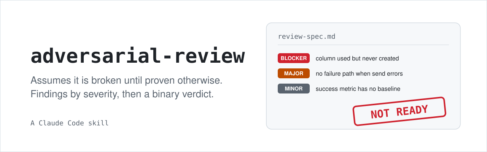

<p align="center">
  <picture>
    <source media="(prefers-color-scheme: dark)" srcset="assets/hero-dark.svg">
    
  </picture>
</p>

<p align="center">
  <a href="LICENSE"></a>
  
</p>

A Claude Code skill that reviews a spec, plan, design, PR, doc or config as if it were broken until proven otherwise, then returns severity-ranked findings and a binary verdict: `NOT READY` or `SHIP IT AS IS`.

## Quick start

```
git clone https://github.com/guydotan55/adversarial-review ~/.claude/skills/adversarial-review
```

Then, in a Claude Code session, before you approve, lock, merge or ship something:

```
/adversarial-review docs/spec.md
```

The skill also triggers on its own when Claude is about to say "looks good" or "this is ready".

## Why use it

A reviewer who wrote the thing, or who wants it to be done, finds what they expect to find. This skill makes the review adversarial by construction:

- **The author never reviews their own work.** The skill dispatches a fresh reviewer with no stake in the artifact, and every re-review is a new fresh reviewer too.
- **Default assumption: it is broken.** Most first passes end in `NOT READY`. A first-pass `SHIP IT AS IS` has to be earned.
- **Every claim is grounded.** Findings cite the place in the artifact they come from; guesses are not findings.
- **No filler.** If a pass is genuinely clean, it says so.

## How it works

1. **Independence.** The author hands the artifact to a fresh reviewer, along with any facts it already verified (seeds). The reviewer re-checks what it can reach; a seed it cannot confirm is reported, and a seed it contradicts becomes a finding.
2. **Severity.** Each finding is a `Blocker`, `Major` or `Minor`, attacked through lenses matched to the artifact's stage (spec, plan, code, UI and so on). Open hard questions are listed separately.
3. **Verdict.** `NOT READY` if there is any Blocker, any Major, or any open hard question. `SHIP IT AS IS` only when nothing worth changing is left.
4. **The loop.** Review, revise, re-review: the author fixes the findings, then a new fresh reviewer re-reviews, until the verdict is `SHIP IT AS IS`. Deferrals are carried forward with a ruling so they do not silently disappear.
5. **Panel escalation needs consent.** For high-stakes artifacts the skill recommends a multi-reviewer panel, with a cost estimate, and waits. "Review this" is not consent to a panel; you have to ask for one or say yes. The playbook is in [references/panel-workflow.md](references/panel-workflow.md).

The full rules are in [SKILL.md](SKILL.md).

## Sample output

```
## Findings
1. [Blocker] §4 vs §9: orders by Contact.lastSurveyedAt, but §9 lists every
   schema change and that column is not among them. Unbuildable as written.
2. [Major] §7: nothing says what happens when the provider rejects a message
   mid-batch. A six-hour drain with no error path fails silently.
3. [Minor] §12: "increase completion" names no baseline, target or window.

## Hard Questions
- What happens when a reminder is due and the messaging window has closed?

## Seeds checked
- "Reminders respect the opt-out list": VERIFIED (read §6)

## Verdict
NOT READY - 1 Blocker, 1 Major, 1 open hard question.
```

## Evals

The skill is tested against six scenarios and a planted-flaw spec with an answer key, so edits to its wording can be checked for regressions. See [evals/](evals/): the [README](evals/README.md) explains how to run them, [RESULTS.md](evals/RESULTS.md) logs past runs.

## Used by guy-loop

[guy-loop](https://github.com/guydotan55/guy-loop) uses this skill for its spec and plan review rounds.

## License

[MIT](LICENSE)
